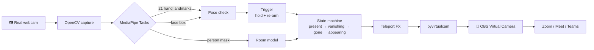

<div align="center">


# ⚡ Goku Transmission

**Put two fingers on your forehead. Vanish from the meeting.**

A virtual webcam that watches for Goku's *Instant Transmission* pose and teleports you out of Zoom, Google Meet, Teams or Discord, leaving an empty room behind. Same pose again and you're back.

[](https://github.com/MuhammadFaizan-prog/goku-Transmission/actions/workflows/tests.yml)


[How it works](#-how-it-works) · [Quick start](#-quick-start) · [Use it in a meeting](#-use-it-in-zoom--meet--teams) · [Testing](#-testing) · [Troubleshooting](#-troubleshooting)

</div>

---

## ✨ What it does

| | |
|---|---|
| 🫡 **The pose** | Index and middle finger straight and **together**, ring and pinky curled, fingertips on your **forehead**. Hold for half a second. |
| ⚡ **The teleport** | A cyan aura charges, comic speed lines run down your silhouette, you squeeze into a beam of light and blink out. About 0.9s, all drawn in code. |
| 🏠 **The empty room** | The meeting sees your real room without you in it. It's learned live, not a frozen screenshot. |
| 🔁 **Coming back** | Lower your hand, do the pose again, and the animation plays in reverse. |
| 🔒 **Private** | Everything runs on your machine. No uploads, no accounts, no recording. |

> Inspired by a viral reel of a developer teleporting out of his meetings. Built from scratch here: original code, MIT licensed.

---

## 🧠 How it works



**1. Seeing the pose**: `goku_transmission/gesture.py`
MediaPipe's hand landmarker gives 21 points per hand. A finger counts as *straight* when its tip reaches well past its middle joint, measured from the wrist. That ratio doesn't care which way your hand points, which matters because the Goku pose is usually sideways across the forehead. Then:

- index + middle straight (`> 1.15`), ring + pinky curled (`< 1.05`)
- tips **together** (gap under 55% of palm width), so a peace sign ✌️ does *not* trigger it
- fingertips inside a **forehead zone** built from the face box. Your hand covers your face mid-pose, so the last face position is remembered for 2s.

**2. Not misfiring**: `GestureTrigger`
Hold for 0.5s (one dropped frame is forgiven). After a teleport you have to lower your hand before the next one counts, so holding the pose never makes you flicker in and out.

**3. The empty room**: `goku_transmission/background.py`
Every frame, the selfie segmenter marks which pixels are you. Every pixel that *isn't* you updates a running "room plate", so it keeps up with changing light. Pixels that have always been behind you get filled with OpenCV inpainting. Step out of frame for 2 to 3 seconds once and the plate is perfect.

**4. The teleport**: `goku_transmission/effects.py`
One function of progress `t ∈ [0, 1]`: **charge** (cyan tint, edge glow, animated vertical speed lines) → **zip** (your silhouette squeezes horizontally into a bright line) → **flash** → **trail** (a fading vertical streak). Reappearing just runs `t` backwards.

**5. Into the meeting**: `pyvirtualcam`
Frames go to a virtual webcam driver (OBS Virtual Camera on Windows/macOS, v4l2loopback on Linux). Meeting apps see it as a normal camera.

---

## 🚀 Quick start

### 1. Install the virtual camera driver
| OS | What to install |
|---|---|
| **Windows** | [OBS Studio](https://obsproject.com/) 28+ (includes *OBS Virtual Camera*) |
| **macOS** | [OBS Studio](https://obsproject.com/) 28+, then click **Start Virtual Camera** once in OBS to register it, then **Stop** |
| **Linux** | `sudo apt install v4l2loopback-dkms && sudo modprobe v4l2loopback devices=1 exclusive_caps=1 card_label="Goku Cam"` |

You don't need to keep OBS open. Just make sure OBS's own *Start Virtual Camera* is **off** while this runs, because only one app can drive it.

### 2. Run it

**Windows (one click):** double-click `scripts\run_windows.bat`. It creates a virtual environment, installs everything and starts the cam.

**Any OS (manual):**
```bash
git clone https://github.com/MuhammadFaizan-prog/goku-Transmission.git
cd goku-Transmission
python -m venv .venv
# Windows: .venv\Scripts\activate     macOS/Linux: source .venv/bin/activate
pip install -r requirements.txt
python -m goku_transmission
```

First run downloads three small MediaPipe models (~8 MB) into `models/`.

### 3. Teleport
1. A preview window opens. Step out of frame for 2 to 3 seconds so the room is learned (the terminal shows `background learned: 100%`).
2. Sit back down. Two fingers together on your forehead, hold ½ second. ⚡
3. Lower your hand. Do it again to come back.

---

## 🎥 Use it in Zoom / Meet / Teams

| App | Where |
|---|---|
| **Zoom** | Settings → Video → Camera → **OBS Virtual Camera** |
| **Google Meet** | ⋮ → Settings → Video → Camera → **OBS Virtual Camera** (restart the browser if it's missing) |
| **Microsoft Teams** | Settings → Devices → Camera → **OBS Virtual Camera** |
| **Discord** | User Settings → Voice & Video → Camera → **OBS Virtual Camera** |

> 🎙️ Your **microphone isn't touched**. Mute yourself when you vanish, or the empty room will keep talking.

---

## ⌨️ Controls & options

**Preview window keys:** `T` teleport manually · `B` relearn the room · `D` toggle debug output · `Q` / `Esc` quit

```bash
python -m goku_transmission --camera 1                # pick another webcam
python -m goku_transmission --width 1920 --height 1080 --fps 30
python -m goku_transmission --hold 0.8                # require a longer hold
python -m goku_transmission --anim 1.2                # slower, more dramatic teleport
python -m goku_transmission --background room.jpg     # use a photo of your empty room
python -m goku_transmission --virtual-backend unitycapture   # Windows alternative to OBS
python -m goku_transmission --no-virtual              # preview only, no driver needed
python -m goku_transmission --mute                    # no teleport sound
python -m goku_transmission --debug                   # print why a pose is / isn't detected
python -m goku_transmission --input me.mp4 --output out.mp4  # process a recorded clip
python -m goku_transmission --self-test               # check the install without a webcam
```

The teleport "zip" sound is synthesized at runtime and plays on **your** speakers only. It never goes into the call.

---

## 🧪 Testing

```bash
pip install -r requirements-dev.txt
python -m pytest -q
```

| Suite | What it proves | Needs |
|---|---|---|
| `tests/test_gesture.py` | The pose is detected; peace sign, open palm, one finger and hand-away-from-forehead are rejected; hold, dropped-frame and re-arm timing | nothing |
| `tests/test_engine.py` | Full present → vanishing → gone → appearing → present cycle; the meeting sees exactly the empty room while gone; holding the pose doesn't bounce you back; the room plate learns and inpaints | nothing |
| `tests/test_real_models.py` | The real MediaPipe models load and run | mediapipe (auto-skips without OpenGL) |

**Test it on yourself without a meeting:**
1. `python -m goku_transmission --self-test`: models load and the effect renders.
2. `python -m goku_transmission --no-virtual --debug`: preview only. Do the pose and watch the terminal: `two_straight`, `others_curled`, `together` and `on_forehead` should all flip to `True`.
3. Record a 10-second clip of yourself doing the pose twice, then:
   ```bash
   python -m goku_transmission --input clip.mp4 --output out.mp4
   GOKU_SAMPLE_VIDEO=clip.mp4 python -m pytest tests/test_real_models.py
   ```
4. Open Zoom → Settings → Video, choose **OBS Virtual Camera** and teleport in the preview.

---

## 🛠️ Troubleshooting

<details>
<summary><b>"no virtual camera" in the terminal</b></summary>

Install OBS Studio 28+. On macOS, start and stop OBS's virtual camera once so the system registers it. Make sure OBS's own *Start Virtual Camera* is off. On Linux, load `v4l2loopback` (see Quick start). The app keeps running in preview-only mode until a driver is there.
</details>

<details>
<summary><b>The pose isn't detected</b></summary>

Run with `--debug`. Usually: fingers too spread (`together: False`; keep index and middle touching), hand too low (`on_forehead: False`), or a dark room. Face the camera with your hand fully in frame.
</details>

<details>
<summary><b>A ghost or blur where I was sitting</b></summary>

The room behind you was never seen, so it was inpainted. Press `B`, step out of frame for 3 seconds, and come back. Or pass `--background` with a photo of your empty room taken from the same webcam.
</details>

<details>
<summary><b>The meeting app doesn't list OBS Virtual Camera</b></summary>

Start Goku Transmission **before** opening the meeting app, or restart the app or browser after starting it.
</details>

<details>
<summary><b>Laggy on an older laptop</b></summary>

Use `--width 960 --height 540`. The models run on CPU, so 720p at 30 fps is comfortable on most laptops from the last 5 years.
</details>

---

## 📁 Project structure

```
goku_transmission/
├── cli.py          # entry point: live webcam, file mode, self-test
├── vision.py       # MediaPipe hand landmarker + face detector + selfie segmenter
├── gesture.py      # pose rules + hold/re-arm trigger (pure Python, unit-tested)
├── background.py   # live empty-room plate with inpainting
├── effects.py      # Instant Transmission animation
├── engine.py       # state machine tying it all together
└── sound.py        # synthesized teleport sound
tests/              # 20 tests, no webcam needed
scripts/            # one-click launchers (Windows .bat, macOS/Linux .sh)
```

## ⚖️ Responsible use

It's a joke tool for friendly calls. Don't use it to fake being present where attendance actually matters.

## 📜 License

[MIT](LICENSE) © 2026 Muhammad Faizan. MediaPipe models are © Google, Apache 2.0.

<div align="center">

**If it made you laugh, drop a ⭐**

</div>
