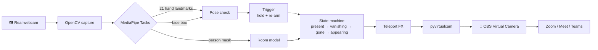

<div align="center">


# ⚡ Goku Transmission

### Put two fingers on your forehead. Vanish from the meeting. 🫡💨

Your webcam watches for Goku's **Instant Transmission** pose and teleports you out of
**Zoom, Google Meet, Teams or Discord**, leaving your empty room behind.
Do it again and you're back.


<sub>Real output of this repo, run on a sample image. Sound plays on your speakers.</sub>

<br/>

[](https://github.com/MuhammadFaizan-prog/goku-Transmission/stargazers)
[](https://github.com/MuhammadFaizan-prog)
[](https://www.linkedin.com/in/muhammad-faizan-60518a290)

[](https://github.com/MuhammadFaizan-prog/goku-Transmission/actions/workflows/tests.yml)


**[🚀 Set it up in 5 minutes](#-set-it-up-in-5-minutes-windows)** · [🫡 How to teleport](#-how-to-teleport) · [😵 Help, it's not working](#-help-its-not-working) · [🤓 How it works](#-how-it-works-for-nerds)

</div>

---

## 👋 Came here from Instagram?

Welcome! Yes, this is the teleport thing, and yes, it actually works. Here's the whole idea:

| 1️⃣ | 2️⃣ | 3️⃣ |
|:---:|:---:|:---:|
| **Leave the frame for a second**<br/>so it snaps a photo of your empty room | **Two fingers on your forehead**<br/>hold for half a second | **⚡ Gone.**<br/>Your call now sees an empty room. Do it again to come back. |

No coding needed. Follow the steps below, copy, paste, done.

> ⭐ **If it makes you laugh, star the repo.** It's free, takes one click, and tells me to build more stuff like this.

---

## 🚀 Set it up in 5 minutes (Windows)

You install three things once. After that it's one double-click.

### Step 1: Install Python
1. Go to **[python.org/downloads](https://www.python.org/downloads/release/python-3119/)** and download **Python 3.11** ("Windows installer 64-bit").
2. Run it. ⚠️ **Tick the box "Add python.exe to PATH"** at the bottom of the first screen, then click *Install Now*.

> Already have Python? Open *Command Prompt* and type `python --version`. **3.10, 3.11 or 3.12** is perfect.

### Step 2: Install OBS (this gives you the fake camera)
1. Download **[OBS Studio](https://obsproject.com/)** and install it with the default options.
2. That's it. You don't need to open OBS or learn it. It just installs the **OBS Virtual Camera** that Zoom and Meet can see.

### Step 3: Download this project
**Easiest:** click the green **`<> Code`** button at the top of this page → **Download ZIP** → right-click the ZIP → **Extract All**.

<details>
<summary>Prefer Git? (click)</summary>

```bash
git clone https://github.com/MuhammadFaizan-prog/goku-Transmission.git
cd goku-Transmission
```
To update later: `git pull`
</details>

### Step 4: Double-click to run
Open the folder, go into **`scripts`**, and double-click **`run_windows.bat`**.

- The **first time** it installs everything by itself. That takes 2 to 5 minutes, so let it finish.
- Next time it starts in seconds.
- A window called **"Goku Transmission - preview"** pops up showing your camera. 🎉

> 🛡️ Windows says *"Windows protected your PC"*? Click **More info → Run anyway**. It's just the .bat file from this repo.

### Step 5: Pick the camera in your meeting app
| App | Where |
|---|---|
| **Zoom** | Settings → Video → Camera → **OBS Virtual Camera** |
| **Google Meet** | ⋮ (three dots) → Settings → Video → **OBS Virtual Camera** |
| **Teams** | ••• → Settings → Devices → Camera → **OBS Virtual Camera** |
| **Discord** | User Settings → Voice & Video → Camera → **OBS Virtual Camera** |

> Keep the Goku window open while you're in the call. Close it and the camera stops.

<details>
<summary>🍎 macOS / 🐧 Linux (click)</summary>

**macOS:** install [OBS](https://obsproject.com/), open it once, click **Start Virtual Camera**, then **Stop** (this registers the camera). Then in Terminal:

```bash
git clone https://github.com/MuhammadFaizan-prog/goku-Transmission.git && cd goku-Transmission
./scripts/run.sh
```

**Linux:**
```bash
sudo apt install v4l2loopback-dkms
sudo modprobe v4l2loopback devices=1 exclusive_caps=1 card_label="Goku Cam"
git clone https://github.com/MuhammadFaizan-prog/goku-Transmission.git && cd goku-Transmission
./scripts/run.sh
```
</details>

---

## 🫡 How to teleport

### 1. Let it photograph your empty room (once)
When the preview opens, you'll see a **red bar** at the top.

**Option A:** just **walk out of the camera completely** for a second. No shoulder, no arm at the edge.
**Option B (most reliable):** click the preview window, press **`B`**, and leave. It counts down **3 seconds** and takes the photo.

If it can still see a face, hand or body when the countdown ends, the bar turns **red: "I can still see part of you"** and it waits until you're fully gone. Your old room is kept until then.
The bar turns **green: "Room captured"**. That room is now **locked**: nothing it sees afterwards (like you walking back in) can get into it.
👀 Want to check it? Press **`R`** to peek at the captured room in the corner (press `R` again to hide it). If any part of you is in it, press **`B`** and try again.

### 2. Teleport
Sit down and do the pose:

> ☝️✌️ **index + middle finger straight and touching**, other fingers curled, **fingertips on your forehead**. Hold for **half a second**.

A blue bar fills at the bottom of the preview, then **⚡ shyun!** you're gone.

### 3. Come back
Lower your hand, then do the pose again. You reappear with the same effect in reverse.

### ⌨️ Keys
Click the preview window first, then:

| Key | What it does |
|:---:|---|
| **`T`** | Teleport without the pose (for when your hand is busy holding chai ☕) |
| **`B`** | 3-second countdown, then re-photograph your empty room |
| **`R`** | Peek at the captured empty room (press again to hide) |
| **`D`** | Show debug info and FPS in the black window |
| **`Q`** | Quit |

### 🔊 The sound
The Instant Transmission sound plays **every time you vanish and every time you come back**, on **your** speakers only. People in the call don't hear it.
Want a different sound? Put a file named **`teleport.mp3`** (or `.wav`) inside the **`sounds`** folder.

<details>
<summary>⚙️ Extra options for power users (click)</summary>

Run these from a terminal inside the project folder (after the first run, `.venv\Scripts\activate` on Windows):

```bash
python -m goku_transmission --camera 1           # use your second webcam
python -m goku_transmission --hold 0.3           # trigger faster
python -m goku_transmission --anim 0.6           # slower teleport (default 0.3s, like the reel)
python -m goku_transmission --sound shyun.mp3    # your own sound
python -m goku_transmission --mute               # no sound
python -m goku_transmission --width 960 --height 540   # faster on old laptops
python -m goku_transmission --background room.jpg      # use a photo as the empty room
python -m goku_transmission --no-virtual         # preview only, no fake camera
python -m goku_transmission --debug              # print what the gesture detector sees
python -m goku_transmission --no-threads         # troubleshooting: run the AI models on the main thread
python -m goku_transmission --self-test          # check the install without a webcam
python -m goku_transmission --input in.mp4 --output out.mp4   # run on a video file
```

On Windows you can also pass options to the launcher: `scripts\run_windows.bat --debug`
</details>

---

## 😵 Help, it's not working

<details>
<summary><b>"python is not recognized"</b></summary>

Python isn't on PATH. Reinstall Python and **tick "Add python.exe to PATH"**. Then close and reopen the window.
</details>

<details>
<summary><b>The install fails / "No matching distribution found for mediapipe"</b></summary>

Your Python is too new or too old. Install **Python 3.11** (link in Step 1), delete the **`.venv`** folder inside the project, and double-click `run_windows.bat` again.
</details>

<details>
<summary><b>Zoom / Meet doesn't show "OBS Virtual Camera"</b></summary>

Install OBS (Step 2), then **fully quit and reopen** Zoom/Meet/Chrome. In OBS, make sure **Start Virtual Camera is OFF**, because only one app can use it at a time.
</details>

<details>
<summary><b>When I vanish, part of me is still there (shoulder, arm, a ghost)</b></summary>

The room photo caught you. Click the preview, press **`B`**, and be **completely** out of the frame before the countdown hits 0. Press **`R`** to check the captured room. Don't move the laptop afterwards. If the lighting changes a lot (lamp on, sunset), press **`B`** again.
</details>

<details>
<summary><b>The pose doesn't trigger</b></summary>

- Keep your **face visible** and well lit.
- Press the **two fingertips together**: a peace sign ✌️ won't work on purpose.
- Ring and pinky **curled**.
- Run with `--debug`. Each word (`two_straight`, `others_curled`, `together`, `on_forehead`) should turn `True` while you hold it.
</details>

<details>
<summary><b>"Pose seen, but I haven't seen your empty room yet"</b></summary>

You skipped the room photo. Press **`B`** and leave the frame for 3 seconds.
</details>

<details>
<summary><b>The keys don't do anything</b></summary>

Click on the **preview window** first. Keys typed into the black terminal window are ignored.
</details>

<details>
<summary><b>It's laggy</b></summary>

Press **`D`** and check the FPS in the terminal. Under 20? Run `scripts\run_windows.bat --width 960 --height 540` and close browser tabs playing video.
</details>

<details>
<summary><b>No sound</b></summary>

Check your volume and that you didn't pass `--mute`. The sound is in `sounds\goku_teleport.wav`. If you put your own `teleport.mp3` there, make sure it plays in a normal media player.
</details>

<details>
<summary><b>Lots of <code>W0000 ...</code> warnings in the black window</b></summary>

Harmless. Those come from Google's MediaPipe library. Ignore them.
</details>

Still stuck? **[Open an issue](https://github.com/MuhammadFaizan-prog/goku-Transmission/issues/new)** with a screenshot of the black window.

---

## 🤓 How it works (for nerds)

<details>
<summary>Architecture, pose math, room model, effect timing (click)</summary>



**1. Seeing the pose**: `goku_transmission/gesture.py`
MediaPipe's hand landmarker gives 21 points per hand. A finger counts as *straight* when its tip reaches well past its middle joint, measured from the wrist. That ratio doesn't care which way your hand points, which matters because the Goku pose is usually sideways across the forehead. Then:

- index + middle straight (`> 1.15`), ring + pinky curled (`< 1.05`)
- tips **together** (gap under 55% of palm width), so a peace sign ✌️ does *not* trigger it
- fingertips inside a **forehead zone** built from the face box. Your hand covers your face mid-pose, so the last face position is remembered for 2s.

**2. Not misfiring**: `GestureTrigger`
Hold for 0.5s (one dropped frame is forgiven). After a teleport you have to lower your hand before the next one counts, so holding the pose never makes you flicker in and out.

**3. The empty room**: `goku_transmission/background.py`
When the segmenter sees nobody for 0.7s (you stepped out), that frame becomes the room plate. After that it only follows slow lighting changes on pixels that still look like the room, and it is frozen while you are gone, so nothing in front of the camera (a missed arm, your shadow) can get baked into the room. Until the room is captured, teleporting is blocked with a hint, because a guessed room looks like a smeared ghost (`--allow-guess` overrides this).

**4. The teleport**: `goku_transmission/effects.py`
Matched frame by frame to the reference reel at 30 fps. **Vanish:** 2 frames of thin white and dark vertical lines over the whole picture while you're still there → hard cut to the empty room with a faint afterimage and a glowing outline of your silhouette → 6 frames where only the outline and lines remain, fading out. **Reappear:** outline flashes on the empty room → you snap back in with a one-frame sideways jolt under the lines → the lines thin out. It's a cut, not a fade, which is what sells the teleport.

**Speed.** The webcam is read on its own thread (always the newest frame, never a backlog), the models run on a 640 px copy, face detection runs every 3rd frame, and only one hand is tracked. In testing it held about 28 to 30 fps at 720p on a modest ARM CPU, including during the animation.

**5. Into the meeting**: `pyvirtualcam`
Frames go to a virtual webcam driver (OBS Virtual Camera on Windows/macOS, v4l2loopback on Linux). Meeting apps see it as a normal camera.

</details>

<details>
<summary>🧪 Tests (click)</summary>

```bash
pip install -r requirements-dev.txt
python -m pytest -q
```

| Suite | What it proves | Needs |
|---|---|---|
| `tests/test_gesture.py` | The pose is detected; peace sign, open palm, one finger and hand-away-from-forehead are rejected; hold, dropped-frame and re-arm timing | nothing |
| `tests/test_engine.py` | Full present → vanishing → gone → appearing → present cycle; the meeting sees exactly the empty room while gone; holding the pose doesn't bounce you back; room capture on step-out; no ghost after 10s of sitting; learning pauses while hands move; teleport blocked until the room is captured | nothing |
| `tests/test_real_models.py` | The real MediaPipe models load and run | mediapipe (auto-skips without OpenGL) |

**Test it on yourself without a meeting:**
1. `python -m goku_transmission --self-test`: models load and the effect renders.
2. `python -m goku_transmission --no-virtual --debug`: preview only. Do the pose and watch the terminal: `two_straight`, `others_curled`, `together` and `on_forehead` should all flip to `True`.
3. Record a 10-second clip of yourself doing the pose twice, then:
   ```bash
   python -m goku_transmission --input clip.mp4 --output out.mp4
   GOKU_SAMPLE_VIDEO=clip.mp4 python -m pytest tests/test_real_models.py
   ```
4. Open Zoom → Settings → Video, choose **OBS Virtual Camera** and teleport in the preview.

</details>

<details>
<summary>📁 Project structure (click)</summary>

```
goku_transmission/
├── cli.py          # entry point: live webcam, file mode, self-test
├── vision.py       # MediaPipe hand landmarker + face detector + selfie segmenter
├── gesture.py      # pose rules + hold/re-arm trigger (pure Python, unit-tested)
├── background.py   # empty-room capture (step out or B countdown)
├── effects.py      # Instant Transmission animation, timed to the reel
├── engine.py       # state machine tying it all together
└── sound.py        # plays sounds/goku_teleport.wav (or your teleport.mp3)
tests/              # 32 tests, no webcam needed
scripts/            # one-click launchers (Windows .bat, macOS/Linux .sh)
docs/               # banner + demo GIF
```
</details>

---

## ⚖️ Responsible use
It's a joke tool for friendly calls. Don't use it to fake being present where attendance actually matters. 🙃

## 📜 License & credits
Code: [MIT](LICENSE) © 2026 Muhammad Faizan.
MediaPipe models © Google (Apache 2.0). The Instant Transmission sound and Dragon Ball © their owners (Akira Toriyama / Toei Animation). This is a non-commercial fan project.
Inspired by a viral reel of a developer teleporting out of his meetings. All code here was written from scratch.

<div align="center">

### Made with ⚡ by [Muhammad Faizan](https://github.com/MuhammadFaizan-prog)

If this made you laugh, **[⭐ star the repo](https://github.com/MuhammadFaizan-prog/goku-Transmission)** and **[follow me](https://github.com/MuhammadFaizan-prog)** for more.

</div>
