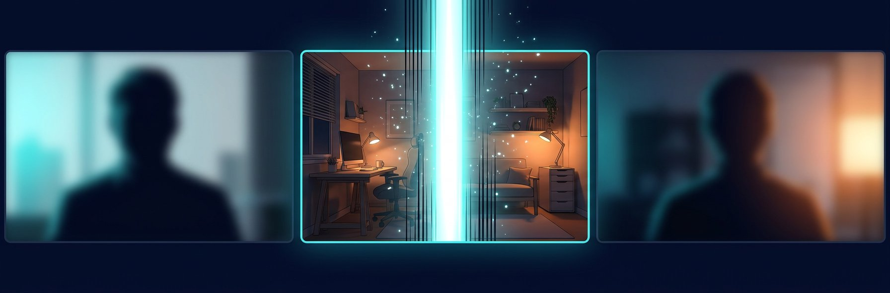
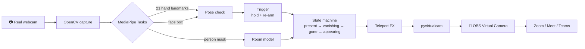

<div align="center">



# ⚡ Goku Transmission

**Put two fingers on your forehead. Vanish from the meeting.**

A virtual webcam that watches for Goku's *Instant Transmission* pose and teleports you out of Zoom, Google Meet, Teams or Discord, leaving an empty room behind. Same pose again and you're back.

[](https://github.com/MuhammadFaizan-prog/goku-Transmission/actions/workflows/tests.yml)


[How it works](#-how-it-works) · [Quick start](#-quick-start) · [Use it in a meeting](#-use-it-in-zoom--meet--teams) · [Testing](#-testing) · [Troubleshooting](#-troubleshooting)

</div>

---

## ✨ What it does

| | |
|---|---|
| 🫡 **The pose** | Index and middle finger straight and **together**, ring and pinky curled, fingertips on your **forehead**. Hold for half a second. |
| ⚡ **The teleport** | Timed frame by frame against the original reel: thin lines rain over the frame, you cut out, a glowing outline of you hangs in the air and fades. About 0.3s, all drawn in code, with your sound on every vanish and return. |
| 🏠 **The empty room** | Step out of frame for 1 second and your real empty room is captured. While you're gone, that's what the meeting sees. |
| 🔁 **Coming back** | Lower your hand, do the pose again, and the animation plays in reverse. |
| 🔒 **Private** | Everything runs on your machine. No uploads, no accounts, no recording. |

> Inspired by a viral reel of a developer teleporting out of his meetings. Built from scratch here: original code, MIT licensed.

---

## 🧠 How it works



**1. Seeing the pose**: `goku_transmission/gesture.py`
MediaPipe's hand landmarker gives 21 points per hand. A finger counts as *straight* when its tip reaches well past its middle joint, measured from the wrist. That ratio doesn't care which way your hand points, which matters because the Goku pose is usually sideways across the forehead. Then:

- index + middle straight (`> 1.15`), ring + pinky curled (`< 1.05`)
- tips **together** (gap under 55% of palm width), so a peace sign ✌️ does *not* trigger it
- fingertips inside a **forehead zone** built from the face box. Your hand covers your face mid-pose, so the last face position is remembered for 2s.

**2. Not misfiring**: `GestureTrigger`
Hold for 0.5s (one dropped frame is forgiven). After a teleport you have to lower your hand before the next one counts, so holding the pose never makes you flicker in and out.

**3. The empty room**: `goku_transmission/background.py`
When the segmenter sees nobody for 0.7s (you stepped out), that frame becomes the room plate. After that it only follows slow lighting changes on pixels that still look like the room, and it is frozen while you are gone, so nothing in front of the camera (a missed arm, your shadow) can get baked into the room. Until the room is captured, teleporting is blocked with a hint, because a guessed room looks like a smeared ghost (`--allow-guess` overrides this).

**4. The teleport**: `goku_transmission/effects.py`
Matched frame by frame to the reference reel at 30 fps. **Vanish:** 2 frames of thin white and dark vertical lines over the whole picture while you're still there → hard cut to the empty room with a faint afterimage and a glowing outline of your silhouette → 6 frames where only the outline and lines remain, fading out. **Reappear:** outline flashes on the empty room → you snap back in with a one-frame sideways jolt under the lines → the lines thin out. It's a cut, not a fade, which is what sells the teleport.

**Speed.** The webcam is read on its own thread (always the newest frame, never a backlog), the models run on a 640 px copy, face detection runs every 3rd frame, and only one hand is tracked. In testing it held about 28 to 30 fps at 720p on a modest ARM CPU, including during the animation.

**5. Into the meeting**: `pyvirtualcam`
Frames go to a virtual webcam driver (OBS Virtual Camera on Windows/macOS, v4l2loopback on Linux). Meeting apps see it as a normal camera.

---

## 🚀 Quick start

### 1. Install the virtual camera driver
| OS | What to install |
|---|---|
| **Windows** | [OBS Studio](https://obsproject.com/) 28+ (includes *OBS Virtual Camera*) |
| **macOS** | [OBS Studio](https://obsproject.com/) 28+, then click **Start Virtual Camera** once in OBS to register it, then **Stop** |
| **Linux** | `sudo apt install v4l2loopback-dkms && sudo modprobe v4l2loopback devices=1 exclusive_caps=1 card_label="Goku Cam"` |

You don't need to keep OBS open. Just make sure OBS's own *Start Virtual Camera* is **off** while this runs, because only one app can drive it.

### 2. Run it

**Windows (one click):** double-click `scripts\run_windows.bat`. It creates a virtual environment, installs everything and starts the cam.

**Any OS (manual):**
```bash
git clone https://github.com/MuhammadFaizan-prog/goku-Transmission.git
cd goku-Transmission
python -m venv .venv
# Windows: .venv\Scripts\activate     macOS/Linux: source .venv/bin/activate
pip install -r requirements.txt
python -m goku_transmission
```

First run downloads three small MediaPipe models (~8 MB) into `models/`.

### 3. Teleport
1. A preview window opens with a red banner. **Leave the frame completely** (no shoulder or arm at the edge) and stay still for 1 second; it turns green: *Room captured*. A small *room* thumbnail in the corner shows exactly what the meeting will see when you vanish. If any part of you is in it, press `B` and do it again.
2. Sit back down. Two fingers together on your forehead and hold ½ second (a cyan bar fills at the bottom of the preview). ⚡
3. Lower your hand. Do it again to come back.

> The terminal prints a few `W0000 ... landmark_projection` / `inference_runner` warnings at start. They come from MediaPipe and are harmless.

---

## 🎥 Use it in Zoom / Meet / Teams

| App | Where |
|---|---|
| **Zoom** | Settings → Video → Camera → **OBS Virtual Camera** |
| **Google Meet** | ⋮ → Settings → Video → Camera → **OBS Virtual Camera** (restart the browser if it's missing) |
| **Microsoft Teams** | Settings → Devices → Camera → **OBS Virtual Camera** |
| **Discord** | User Settings → Voice & Video → Camera → **OBS Virtual Camera** |

> 🎙️ Your **microphone isn't touched**. Mute yourself when you vanish, or the empty room will keep talking.

---

## ⌨️ Controls & options

**Preview window keys:** `T` teleport manually · `B` recapture the room · `D` toggle debug output (shows fps too) · `Q` / `Esc` quit

```bash
python -m goku_transmission --camera 1                # pick another webcam
python -m goku_transmission --width 1920 --height 1080 --fps 30
python -m goku_transmission --hold 0.8                # require a longer hold
python -m goku_transmission --anim 0.6                # slower teleport (default 0.3s, like the reel)
python -m goku_transmission --sound shyun.mp3         # your own teleport sound (.mp3 / .wav)
python -m goku_transmission --allow-guess             # teleport before the room was captured
python -m goku_transmission --background room.jpg     # use a photo of your empty room
python -m goku_transmission --virtual-backend unitycapture   # Windows alternative to OBS
python -m goku_transmission --no-virtual              # preview only, no driver needed
python -m goku_transmission --mute                    # no teleport sound
python -m goku_transmission --debug                   # print why a pose is / isn't detected
python -m goku_transmission --input me.mp4 --output out.mp4  # process a recorded clip
python -m goku_transmission --self-test               # check the install without a webcam
```

**Sound:** the Instant Transmission sound plays every time you vanish and every time you reappear. Want a different one? Put `teleport.mp3` or `teleport.wav` in the `sounds/` folder (gitignored) or pass `--sound file.mp3`. MP3 works out of the box on Windows and macOS. It plays on **your** speakers only and never goes into the call.

---

## 🧪 Testing

```bash
pip install -r requirements-dev.txt
python -m pytest -q
```

| Suite | What it proves | Needs |
|---|---|---|
| `tests/test_gesture.py` | The pose is detected; peace sign, open palm, one finger and hand-away-from-forehead are rejected; hold, dropped-frame and re-arm timing | nothing |
| `tests/test_engine.py` | Full present → vanishing → gone → appearing → present cycle; the meeting sees exactly the empty room while gone; holding the pose doesn't bounce you back; room capture on step-out; no ghost after 10s of sitting; learning pauses while hands move; teleport blocked until the room is captured | nothing |
| `tests/test_real_models.py` | The real MediaPipe models load and run | mediapipe (auto-skips without OpenGL) |

**Test it on yourself without a meeting:**
1. `python -m goku_transmission --self-test`: models load and the effect renders.
2. `python -m goku_transmission --no-virtual --debug`: preview only. Do the pose and watch the terminal: `two_straight`, `others_curled`, `together` and `on_forehead` should all flip to `True`.
3. Record a 10-second clip of yourself doing the pose twice, then:
   ```bash
   python -m goku_transmission --input clip.mp4 --output out.mp4
   GOKU_SAMPLE_VIDEO=clip.mp4 python -m pytest tests/test_real_models.py
   ```
4. Open Zoom → Settings → Video, choose **OBS Virtual Camera** and teleport in the preview.

---

## 🛠️ Troubleshooting

<details>
<summary><b>"no virtual camera" in the terminal</b></summary>

Install OBS Studio 28+. On macOS, start and stop OBS's virtual camera once so the system registers it. Make sure OBS's own *Start Virtual Camera* is off. On Linux, load `v4l2loopback` (see Quick start). The app keeps running in preview-only mode until a driver is there.
</details>

<details>
<summary><b>The pose isn't detected</b></summary>

Run with `--debug`. Usually: fingers too spread (`together: False`; keep index and middle touching), hand too low (`on_forehead: False`), or a dark room. Face the camera with your hand fully in frame.
</details>

<details>
<summary><b>A ghost or blur where I was sitting</b></summary>

Press `B`, step fully out of frame for 1 second (until the banner turns green), and come back. Don't move the webcam afterwards. Or pass `--background` with a photo of your empty room taken from the same webcam.
</details>

<details>
<summary><b>The meeting app doesn't list OBS Virtual Camera</b></summary>

Start Goku Transmission **before** opening the meeting app, or restart the app or browser after starting it.
</details>

<details>
<summary><b>Laggy on an older laptop</b></summary>

Run with `--debug` and check the fps. If it's under 20, use `--width 960 --height 540`. Close other apps using the GPU/CPU (browser tabs with video).
</details>

---

## 📁 Project structure

```
goku_transmission/
├── cli.py          # entry point: live webcam, file mode, self-test
├── vision.py       # MediaPipe hand landmarker + face detector + selfie segmenter
├── gesture.py      # pose rules + hold/re-arm trigger (pure Python, unit-tested)
├── background.py   # live empty-room plate with inpainting
├── effects.py      # Instant Transmission animation
├── engine.py       # state machine tying it all together
└── sound.py        # synthesized teleport sound (or your own sounds/teleport.wav)
tests/              # 25 tests, no webcam needed
scripts/            # one-click launchers (Windows .bat, macOS/Linux .sh)
```

## ⚖️ Responsible use

It's a joke tool for friendly calls. Don't use it to fake being present where attendance actually matters.

## 📜 License

[MIT](LICENSE) © 2026 Muhammad Faizan. MediaPipe models are © Google, Apache 2.0.

<div align="center">

**If it made you laugh, drop a ⭐**

</div>
